# 아이템 조합법·획득처

InfraCraft 의 모든 아이템은 **조합하거나, 또는 다른 곳에서 얻어요.** 조합할 수 있는 아이템은 조합대 그림을 함께 실었어요.
조합법이 없는 아이템은 구조물 상자나 교역, 설계도로 얻어요. 게임 안에서는 레시피 책(또는 JEI·EMI)으로도 볼 수 있어요.

| 얻는 법 | 아이템 |
|---|---|
| 조합 (31) | 아스팔트, 차선 아스팔트, 가로등, 이정표, 도로 포장기, 고속 선로, 특급 선로, 블레이즈 선로, 엔더 선로 핵, 역, 분기기, 승차권, 선로 부설기, 측량기, 터널 굴착기, 실드 굴진기, 터널 라이닝, 터널 조명, 승강장 안전선, 승강장 안전문, 역 승강기, 지하철 건설 안내서, 지하 역사 설계도, 지상 역사 설계도, 전동차 도면, 객차 도면, 물살 블록, 보트 리프트, 마구간, 말 호루라기, 철 편자 |
| 획득 (4) | 항구 설계도, 교역소, 화물 상자, 다이아몬드 편자 |

> 그림은 `recipe-images` 워크플로가 게임 jar 의 텍스처로 그려요(`tools/recipes/render_recipes.py`). 이 문서는 `python3 tools/recipes/items_doc.py` 로 다시 만들어요.

## 도로

### 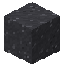 아스팔트
Asphalt · `infracraft:asphalt`

**조합** → 8개

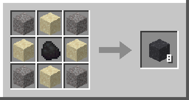

재료: 자갈 4 + 모래 4 + 석탄 1

### 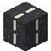 차선 아스팔트
Lane-Marked Asphalt · `infracraft:road_line`

**조합** → 4개

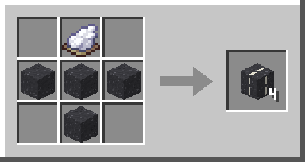

재료: 흰색 염료 1 + 아스팔트 4

###  가로등
Street Lamp · `infracraft:street_lamp`

**조합** → 1개

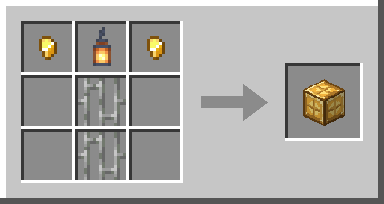

재료: 금 조각 2 + 랜턴 1 + 철창 2

### 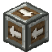 이정표
Signpost · `infracraft:signpost`

**조합** → 2개

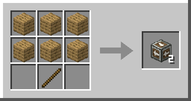

재료: 판자 6 + 막대기 1

###  도로 포장기
Road Paver · `infracraft:road_paver`

**조합** → 1개

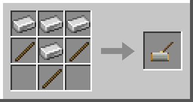

재료: 철 주괴 4 + 막대기 3

## 철도

### 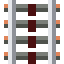 고속 선로
High-Speed Rail · `infracraft:high_speed_rail`

**조합** → 6개

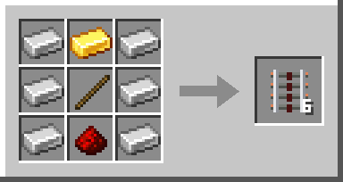

재료: 철 주괴 6 + 금 주괴 1 + 막대기 1 + 레드스톤 가루 1

###  특급 선로
Express Rail · `infracraft:express_rail`

**조합** → 16개

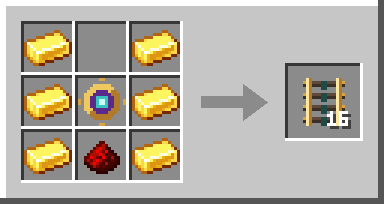

재료: 금 주괴 6 + 엔더 선로 핵 1 + 레드스톤 가루 1

###  블레이즈 선로
Blaze Rail · `infracraft:blaze_rail`

**조합** → 6개

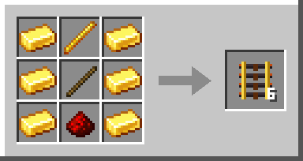

재료: 금 주괴 6 + 블레이즈 막대기 1 + 막대기 1 + 레드스톤 가루 1

###  엔더 선로 핵
Ender Rail Core · `infracraft:ender_rail_core`

**조합** → 1개

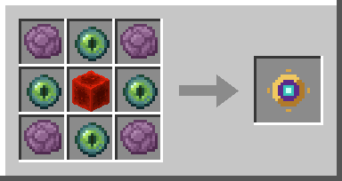

재료: 튀긴 후렴과 4 + 엔더의 눈 4 + 레드스톤 블록 1

###  역
Station · `infracraft:station`

**조합** → 1개

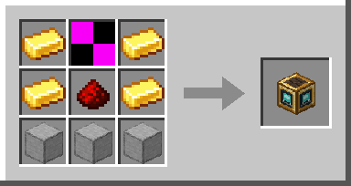

재료: 금 주괴 4 + 나침반 1 + 레드스톤 가루 1 + 매끄러운 돌 3

### 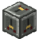 분기기
Rail Switch · `infracraft:rail_switch`

**조합** → 1개

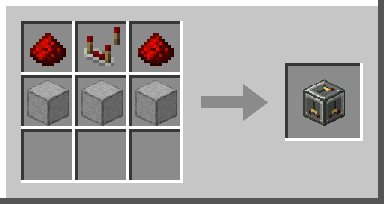

재료: 레드스톤 가루 2 + 레드스톤 비교기 1 + 매끄러운 돌 3

###  승차권
Ticket · `infracraft:ticket`

**조합** → 8개

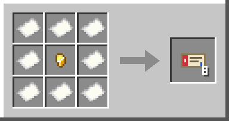

재료: 종이 8 + 금 조각 1

### 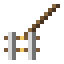 선로 부설기
Track Layer · `infracraft:track_layer`

**조합** → 1개

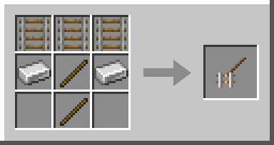

재료: 레일 3 + 철 주괴 2 + 막대기 2

### 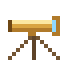 측량기
Surveyor · `infracraft:surveyor`

**조합** → 1개

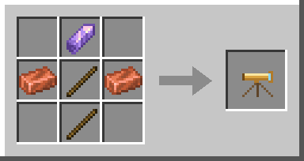

재료: 자수정 조각 1 + 구리 주괴 2 + 막대기 2

## 지하철

### 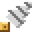 터널 굴착기
Tunnel Borer · `infracraft:tunnel_borer`

**조합** → 1개

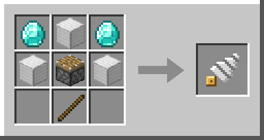

재료: 다이아몬드 2 + 철 블록 3 + 피스톤 1 + 막대기 1

###  실드 굴진기
Subway Shield Machine · `infracraft:subway_shield`

**조합** → 1개

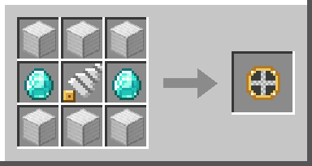

재료: 철 블록 6 + 다이아몬드 2 + 터널 굴착기 1

###  터널 라이닝
Tunnel Lining · `infracraft:tunnel_lining`

**조합** → 16개

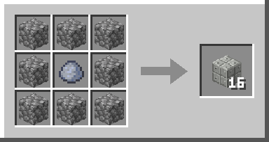

재료: 돌 종류 8 + 점토 덩이 1

###  터널 조명
Tunnel Light · `infracraft:tunnel_light`

**조합** → 4개

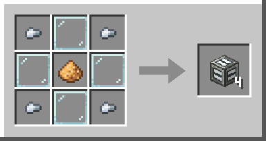

재료: 철 조각 4 + 유리판 4 + 발광석 가루 1

###  승강장 안전선
Platform Edge · `infracraft:platform_edge`

**조합** → 8개

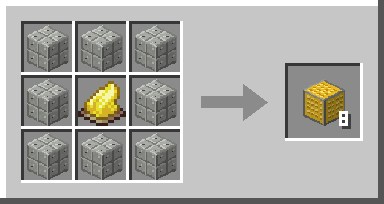

재료: 터널 라이닝 8 + 노란색 염료 1

###  승강장 안전문
Platform Screen Door · `infracraft:screen_door`

**조합** → 2개

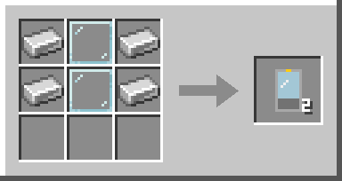

재료: 철 주괴 4 + 유리판 2

###  역 승강기
Station Elevator · `infracraft:station_elevator`

**조합** → 1개

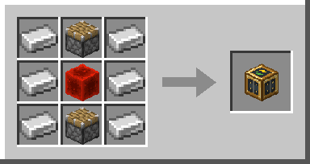

재료: 철 주괴 6 + 피스톤 2 + 레드스톤 블록 1

### 지하철 건설 안내서
완성된 책(바닐라 아이템)

**조합** → 1개

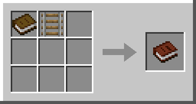

재료: 책 1 + 레일 1

## 역사 설계도

###  지하 역사 설계도
Underground Station Blueprint · `infracraft:station_blueprint`

**조합** → 1개

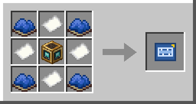

재료: 파란색 염료 4 + 종이 4 + 역 1

###  지상 역사 설계도
Surface Station Blueprint · `infracraft:ground_station_blueprint`

**조합** → 1개

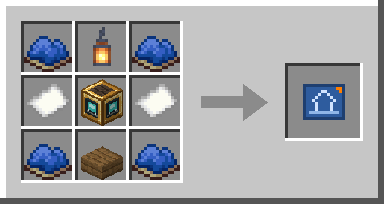

재료: 파란색 염료 4 + 랜턴 1 + 종이 2 + 역 1 + 가문비나무 반 블록 1

### 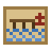 항구 설계도
Harbor Blueprint · `infracraft:harbor_blueprint`

**획득**

- 난파선 지도 상자: 35%
- 난파선 보급품 상자: 15%
- 큰 해저 유적 상자: 20%
- 마을 어부 집 상자: 20%

## 차량 도면 (Create)

###  전동차 도면
Metro Car Plan · `infracraft:metro_car_blueprint`

**조합** → 1개 · *Create 가 있을 때만*

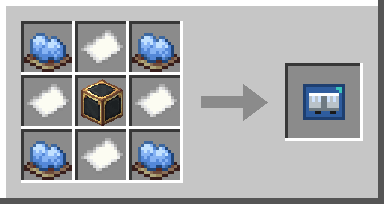

재료: 하늘색 염료 4 + 종이 4 + 기차 케이스(Create) 1

###  객차 도면
Passenger Coach Plan · `infracraft:coach_blueprint`

**조합** → 1개 · *Create 가 있을 때만*

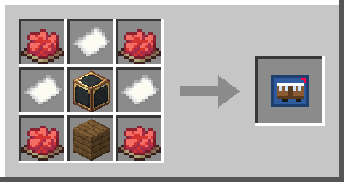

재료: 빨간색 염료 4 + 종이 3 + 기차 케이스(Create) 1 + 가문비나무 판자 1

## 수운·항구

###  물살 블록
Water Current · `infracraft:water_current`

**조합** → 4개

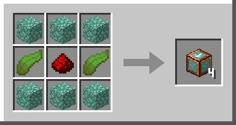

재료: 프리즈머린 6 + 켈프 2 + 레드스톤 가루 1

### 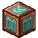 보트 리프트
Boat Lift · `infracraft:boat_lift`

**조합** → 1개

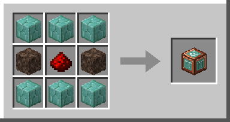

재료: 프리즈머린 벽돌 6 + 영혼 모래 2 + 레드스톤 가루 1

###  교역소
Trading Post · `infracraft:trading_post`

**획득**

- **항구 설계도**를 쓰면 잔교 입구에 설치돼요. 부수면 아이템으로 회수해 옮길 수 있어요.

### 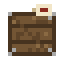 화물 상자
Cargo Crate · `infracraft:cargo_crate`

**획득**

- **교역소**에 그 항구의 특산품을 들고 쓰면 받아요(최대 64개를 담아요).

## 말

### 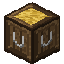 마구간
Stable · `infracraft:stable`

**조합** → 1개

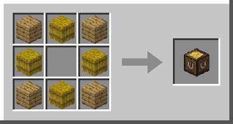

재료: 판자 4 + 건초 더미 4

###  말 호루라기
Horse Whistle · `infracraft:whistle`

**조합** → 1개

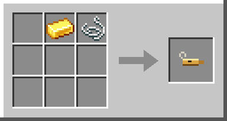

재료: 금 주괴 1 + 실 1

###  철 편자
Iron Horseshoe · `infracraft:iron_horseshoe`

**조합** → 2개

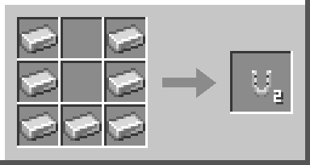

재료: 철 주괴 7

###  다이아몬드 편자
Diamond Horseshoe · `infracraft:diamond_horseshoe`

**획득**

- 마을 무기 대장장이 상자: 12%
- 마을 도구 대장장이 상자: 10%
- 사막 피라미드 상자: 8%
