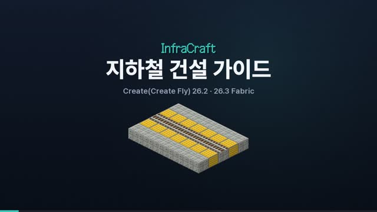

# 지하철 건설 가이드

▶ **[영상으로 보기 (MP4)](videos/subway.mp4)** · 기능별 영상은 [VIDEOS.md](VIDEOS.md) — 굴진, 경사 터널, 물·용암 차단, 지하 역사(안전문·전동차·승강기), 기차와 노선망까지 한 번에 보여 줘요.

겉날개가 없는 세계에서 지하철은 가장 빠르고 안전한 장거리 교통이에요. 이 문서는 InfraCraft 의 **지하철 제작 키트**로 노선 하나를 개통하는 순서를 설명해요. 키트는 터널·트랙·역사를 짓고, **기차 자체는 Create(Create Fly)와 그 애드온**(Steam 'n' Rails 등)이 맡아요. Create 가 없으면 바닐라 선로와 마인카트로도 쓸 수 있어요. 같은 내용을 게임 안에서도 볼 수 있어요. **책 + 레일**을 조합하면 「지하철 건설 안내서」가 나와요.

## 키트 구성

| 아이템 | 조합법 | 역할 |
|---|---|---|
| 실드 굴진기 | 철 블록 6 + 다이아몬드 2 + 터널 굴착기 | 폭 11 × 높이 5 복선 터널 단면을 한 칸씩 뚫고, 라이닝·선로 두 줄·조명을 깔아요 |
| 터널 라이닝 ×16 | 돌 종류 8 + 점토 1 | 터널 벽·바닥·천장. 도로 2등급 |
| 터널 조명 ×4 | 철 조각 4 + 유리판 4 + 발광석 가루 | 천장 조명(밝기 15) |
| 승강장 안전선 ×8 | 터널 라이닝 8 + 노란 염료 | 승강장 가장자리 점자 블록. 도로 2등급 |
| 역 승강기 | 철 주괴 4 + 피스톤 2 + 레드스톤 블록 | 위의 빈 기둥에 선 플레이어를 올리고, 웅크리면 내려요 |
| 승강장 안전문 ×2 | 철 주괴 4 + 유리판 2 | 승강장 가장자리의 두 칸 높이 유리문. 차량이 멈추면 열려요 |
| 지하 역사 설계도 | 파란 염료 4 + 종이 4 + 역 | 승강장, 안전문, 역 블록, 조명, 승강기 수직구를 한 번에 지어요 |
| 전동차 도면 (Create) | 하늘색 염료 4 + 종이 4 + 기차 케이스 | Create 블록으로 지하철 차체(폭 5 × 길이 9)를 짓고 접착제를 붙여요 |

조합법 그림은 [ITEMS.md](ITEMS.md) 에 있어요.

## 1. 준비
- 터널 라이닝은 64개 이상, 넉넉히 만들어 두세요. 단면 하나에 최대 22개가 들고, 역사 하나에는 수백 개가 들어요.
- **Create 트랙**을 인벤토리에 넣어 두면 굴진기가 바닥 가운데에 Create 트랙(직선 `xo`/`zo`, 경사 `an`/`as`/`ae`/`aw`)을 깔아요. Create 트랙이 없으면 바닐라 선로(고속·특급 선로 포함)를 깔아요. 설정 `subwayTrack` 으로 바꿀 수 있어요.
- 터널 조명이 인벤토리에 있으면 8칸마다 천장에 자동으로 달려요. 없으면 그 자리는 라이닝으로 채워요.

## 2. 노선 계획
1. 지상에서 **측량기**로 두 역 자리를 차례로 우클릭하면 수평 거리, 높이 차, 경사가 나와요.
2. 깊이는 Y 0 근처를 추천해요. 대부분의 동굴과 대수층을 피할 수 있어요.
3. 지상에 **이정표**를 두면 가까운 역 방향을 확인할 수 있어요.

## 3. 내려가기
**실드 굴진기**를 들고 아래(40° 이상)를 보면서 쓰면 1:1 내리막 터널이 생겨요. 선로도 경사에 맞춰 이어져요. 위를 보고 쓰면 오르막이에요.

## 4. 굴진
- 정면을 보고 쓸 때마다 앞쪽에서 아직 뚫리지 않은 첫 단면(최대 4칸 앞)이 뚫려요.
  - **두 선로 사이 가운데 줄에 서서** 써요
  - 내부: 폭 11 × 높이 5 (Create 전동차 두 대가 엇갈려 지나가는 크기)
  - 둘레: 라이닝으로 감싸요
  - 바닥 양옆(가운데에서 3칸): 선로 두 줄, 상행·하행(Create 트랙 우선)
- **라이닝을 먼저 깔고 내부를 비우기 때문에** 지하수와 용암이 터널로 새지 않아요.
- 캐낸 블록은 터널 바닥에 떨어져요. 걸어가면서 주우면 돼요.
- 기반암과 블록 엔티티(상자 등)는 건드리지 않아요.
- *절약* 인챈트는 라이닝 소모를 줄이고, *내구성*·*수선*도 붙일 수 있어요.
- **기본이 복선**이라 상행·하행 기차가 마주칠 일이 없어요. 오른쪽 선로가 1번선이에요.

## 5. 지하 역사
1. 역을 만들 자리에서 **두 선로 사이 가운데에 서서 노선 방향을 바라봐요**.
2. **지하 역사 설계도**를 써요.
3. 다음이 한 번에 지어져요.
   - 길이 16칸, 폭 17칸, 높이 6칸 상대식 복선 역사(1번선·2번선)
   - 가운데 트랙. Create 트랙이 16개 이상 있으면 Create 트랙으로 깔고, 아니면 바닐라 선로와 그 아래 **InfraCraft 역 블록**을 놓아요
   - 선로마다 차량이 지나는 폭 5칸은 비워 두고, 바깥 양쪽 승강장은 **선로보다 한 칸 높게**(차량 바닥과 같은 높이라 턱 없이 타요)
   - 승강장 가장자리의 **안전선**과 두 칸 높이 **승강장 안전문**, 천장 조명
   - 양쪽 승강장 끝의 **역 승강기**와 지상까지 뚫린 **수직구**(둘레는 라이닝). 승강기는 순간이동이 아니라 수직구 안에서 실제로 올려 주고, 웅크리면 내려 줘요
4. Create 트랙으로 지었다면 양쪽 승강장 옆 트랙에 **Create 기차 정거장**을 하나씩 놓고 이름을 지어요. 그 역은 InfraCraft 노선망에도 자동으로 등록돼요.
5. 역사를 짓는 데 드는 라이닝은 인벤토리에서 빠져요. 모자라면 필요한 개수를 알려줘요. 역사 자리에서 파낸 블록은 남지 않아요.

## 6. 차량 만들기 (Create)
1. 역사 트랙 옆에 **Create 기차 정거장**을 놓아요.
2. 트랙 위에 서서 노선 방향을 보고 **전동차 도면**(지상 노선이면 **객차 도면**)을 써요. 앞쪽 9칸이 곧은 Create 트랙이어야 해요.
3. 인벤토리의 재료(산업용 철 블록, 산업용 철 유리창, 기차 문, 파란색 좌석, 기차 조종기, 터널 조명)로 차체가 지어지고, 차체 전체에 **강력 접착제**가 붙어요. 모자란 재료는 목록으로 알려 줘요.
   - 폭 5 × 길이 9 × 높이 4. 양옆 롱시트, 양쪽 출입문 두 개씩, 앞뒤 운전대(양방향 운전)
   - 바닥이 선로 +1 이라 지하 역사 승강장과 턱 없이 이어져요
4. 채팅에 나온 **대차 자리 두 칸**의 트랙에 **기차 케이스**를 대어 대차를 놓아요.
5. Create 기차 정거장을 **조립 모드**로 바꾸고 조립하면 지하철이 돼요. 이후 운행은 Create 방식 그대로예요.

차량 자체는 Create 기차예요. InfraCraft 는 차체를 짓는 도면만 줘요.

## 7. 안전 운행
- **Create 기차끼리 부딪치면 Create 규칙대로 멈추고 탈선해요.** 막는 방법은 Create 자체의 **기차 신호기**예요. 역 앞뒤와 갈림길 앞에 기차 신호기를 두어 구간을 나누고, 기차는 **운행 일정**으로 달리게 하세요. 직접 운전할 때는 신호를 지켜야 해요.
- 키트는 기본이 복선이라 상행·하행 정면 충돌은 생기지 않아요.
- Create 기차는 선로 위 사람을 쳐요. 지하 역사의 **승강장 안전문**이 선로로 내려가는 것을 막아요.
- **바닐라 카트**는 **ATS** 가 앞차를 감지해 4칸 간격으로 서고, 앞이 비면 다시 출발해요. 단선에서 맞은편 차가 오면 둘 다 서요. 이때는 뒤로 물러나거나 교행 구간(분기기)을 두세요.

## 8. 기차 운행
- **Create 기차**: 열차 조립, 기차역, 시간표는 모두 Create 방식 그대로예요. Steam 'n' Rails 같은 애드온의 트랙과 차량도 같은 선로망이라 그대로 쓸 수 있어요.
- **바닐라 선로**를 쓴다면 고속·특급 선로는 레드스톤 전원이 있어야 가속해요. 선로 아래 라이닝 몇 칸을 **레드스톤 블록**으로 바꾸면 늘 전원이 들어와요. 카트는 커브 앞에서 자동으로 감속해요.

## 9. 개통과 운행
1. 역 이름: Create 기차 정거장은 Create 에서 지은 이름을 그대로 써요. InfraCraft 역 블록은 **이름표**로 지어요(역 블록 위의 선로를 우클릭해도 돼요).
2. Create 기차나 카트가 두 역 사이를 한 번 달리면 그 구간이 **노선으로 측량**돼요.
3. 바닐라 카트 노선이라면 **승차권**(목적지 역에서 정차)과 **분기기**(목적지별 자동 전환)를 쓸 수 있어요. Create 기차는 Create 시간표와 신호를 써요.
4. 목적지가 있는 승차권으로 역(InfraCraft 역 블록이나 Create 기차 정거장)을 우클릭하면 **가장 빠른 경로**가 나와요.
5. 순간이동(급행)은 없어요. 경로를 확인했으면 직접 타고 가요. Create 기차 정거장의 빈손 클릭은 Create 역 화면 그대로예요.
6. 이정표를 웅크리고 우클릭하면 노선망 요약과 전체 역 목록이 나와요.

## 10. 환승과 네트워크
- 노선망은 탈것이 실제로 달린 구간만 잇기 때문에, 환승역은 두 노선의 역을 짧은 연결 선로로 잇고 카트로 한 번 달려 두면 경로 탐색에 포함돼요.
- 지상으로 나오는 구간은 **지상 역사 설계도**로, 바다를 건너는 구간은 **항구 설계도**와 배로 이어 보세요.
- 네더에서는 블레이즈 선로로 더 빠른 지하 노선을 만들 수 있어요(블레이즈 가루 연료).
